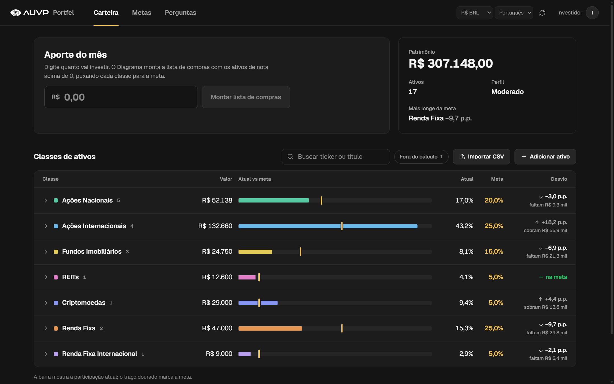
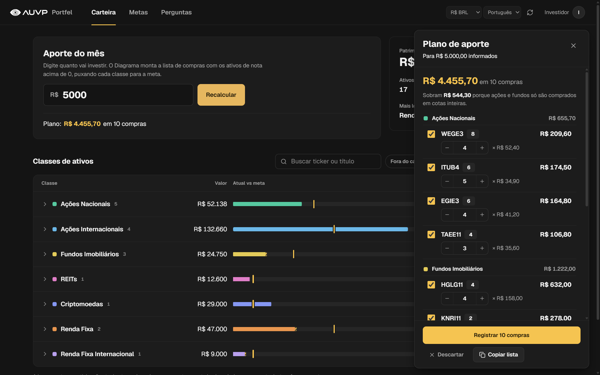
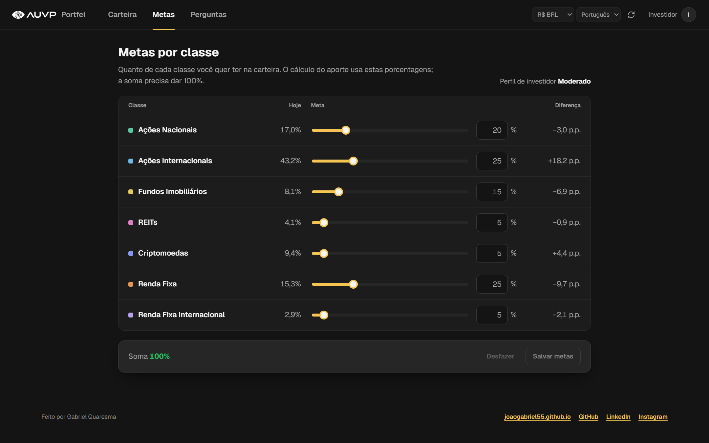
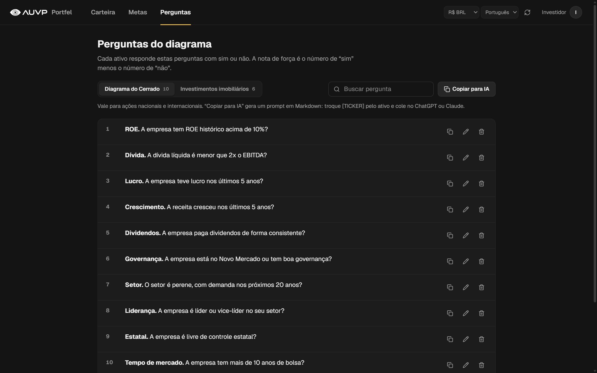
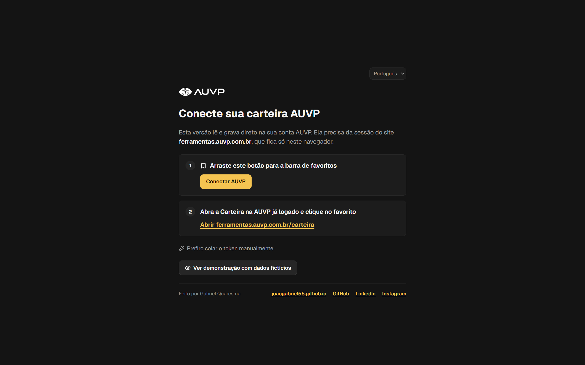
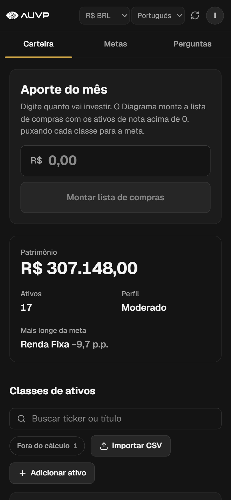

# AUVP Portfel

A redesign proposal for the AUVP wallet page (`ferramentas.auvp.com.br/carteira`), built around the "Diagrama do Cerrado" method.



## Why this exists

I'm an AUVP student, and I built this **voluntarily, in my free time**, to make the experience better for AUVP customers. The goal is to make the monthly routine faster and clearer: see where your wallet stands, decide where this month's contribution (aporte) goes, and record it, with nothing lost from the current page.

- **Unofficial.** This is not an AUVP product, and AUVP has not endorsed it. The AUVP name and logo belong to AUVP and are used only so the proposal looks like the product it could become.
- **Unpaid.** Nobody commissioned or paid for this work. It is offered to the AUVP team as a suggestion they are free to use.
- **No data collected.** The app runs in your browser and talks only to the AUVP backend. Your token and wallet never go anywhere else.

> ⚠️ When connected to a real account, every action (add/edit/delete asset, buy/sell, goals, questions) changes your real AUVP wallet. To look around safely, use the demo (below).

## Screenshots

All screenshots use the built-in demo wallet with sample data.

| Monthly aporte plan | Targets per class |
|---|---|
|  |  |
| **Diagrama questions** | **Connect screen** |
|  |  |

<p align="center"></p>

## Requirements

- [Node.js](https://nodejs.org/) 20.19+ or 22.12+ (required by Vite 8)
- npm (comes with Node)
- An AUVP account with access to [ferramentas.auvp.com.br](https://ferramentas.auvp.com.br)

## Run locally

1. Install dependencies:
   ```sh
   cd app
   npm install
   ```
2. Start the dev server:
   ```sh
   npm run dev
   ```
3. Open the URL Vite prints (default http://localhost:5173).
4. Click **Ver demonstração com dados fictícios** to try it with sample data, or connect your AUVP account (next section).

The demo wallet lives in memory. You can buy, sell, edit and run the aporte plan, and everything resets when you reload the page. Its aporte plan is a rough stand-in for AUVP's real calculation.

## Connect your AUVP account

The app has no login of its own. It uses your existing AUVP session token, which stays in this browser's `localStorage` and is sent only to the AUVP backend.

**Option A: bookmarklet (recommended)**

1. On the app's connect screen, drag **Conectar AUVP** to your bookmarks bar.
2. Open [ferramentas.auvp.com.br/carteira](https://ferramentas.auvp.com.br/carteira) while logged in.
3. Click the bookmark. A new tab opens the app, already connected.

The bookmarklet points to the origin where you dragged it from. If you change the port, drag it again.

**Option B: paste the token**

1. On ferramentas.auvp.com.br (logged in), open the console (F12) and run:
   ```js
   localStorage.getItem('auvp-web@token')
   ```
2. Paste the result into **Prefiro colar o token manualmente** on the connect screen.

If the session expires (for example after reloading the AUVP tab), the app returns to the connect screen. Connect again.

## Scripts

| Command | What it does |
|---|---|
| `npm run dev` | Dev server with hot reload |
| `npm run build` | Type-check (`tsc -b`) and build to `dist/` |
| `npm run preview` | Serve the built `dist/` locally |
| `npm run lint` | Lint with oxlint |

## Features

- **Carteira**: assets grouped by class, distance from target, nota de força, buy/sell, monthly aporte plan, renda fixa import
- **Metas**: target % per asset class (must add up to 100%)
- **Perguntas**: edit the Diagrama do Cerrado questions
- Display currency BRL / USD / EUR (rates from AwesomeAPI) and UI in Português / English / Español

## Author

Made by **Gabriel Quaresma**

- Portfolio: [joaogabriel55.github.io](https://joaogabriel55.github.io/)
- GitHub: [@joaogabriel55](https://github.com/joaogabriel55)
- LinkedIn: [gabriel-quaresma-dev](https://www.linkedin.com/in/gabriel-quaresma-dev/)
- Instagram: [@drawquaresma](https://www.instagram.com/drawquaresma/)
